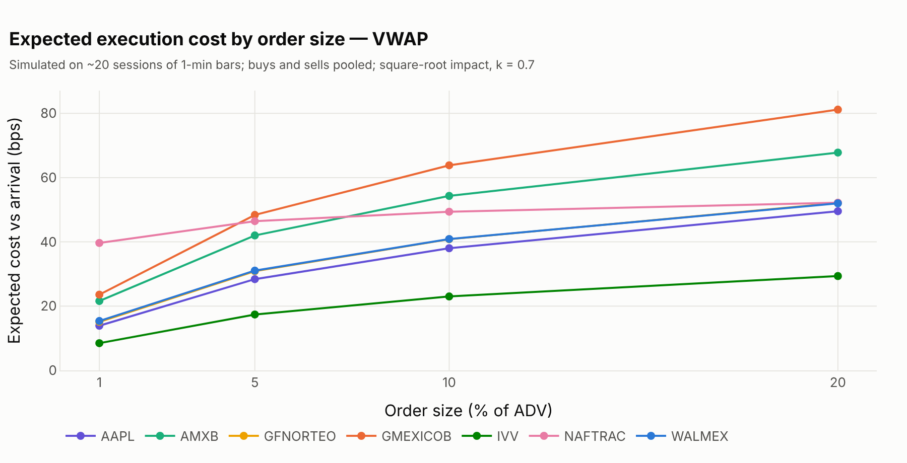
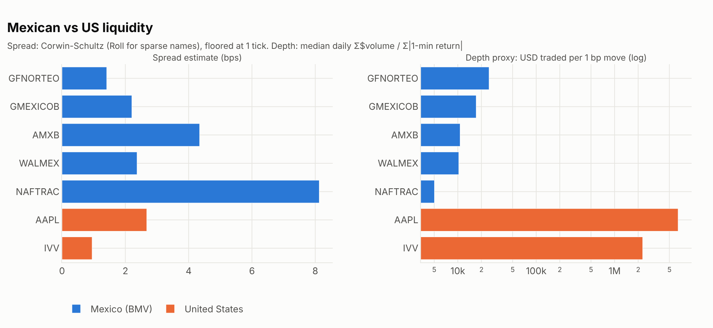
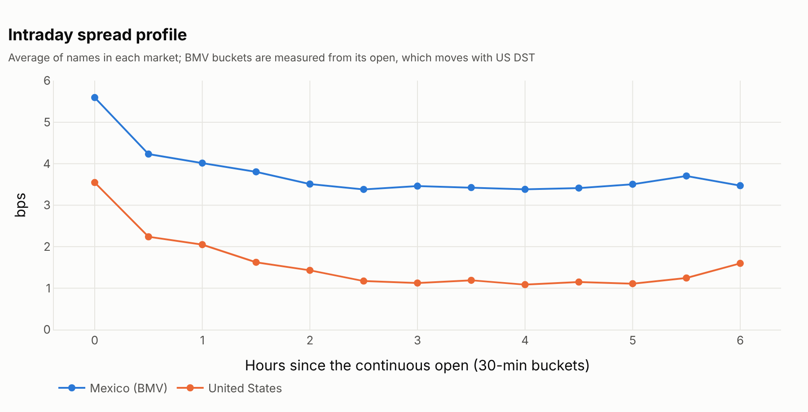
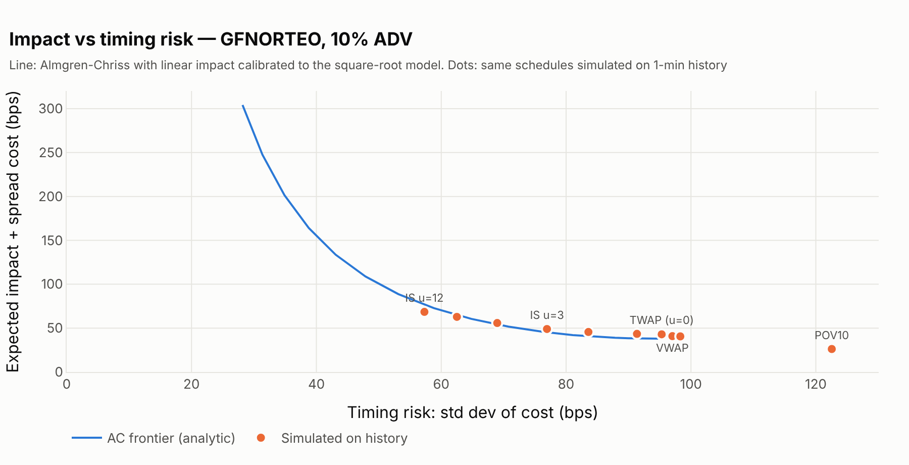
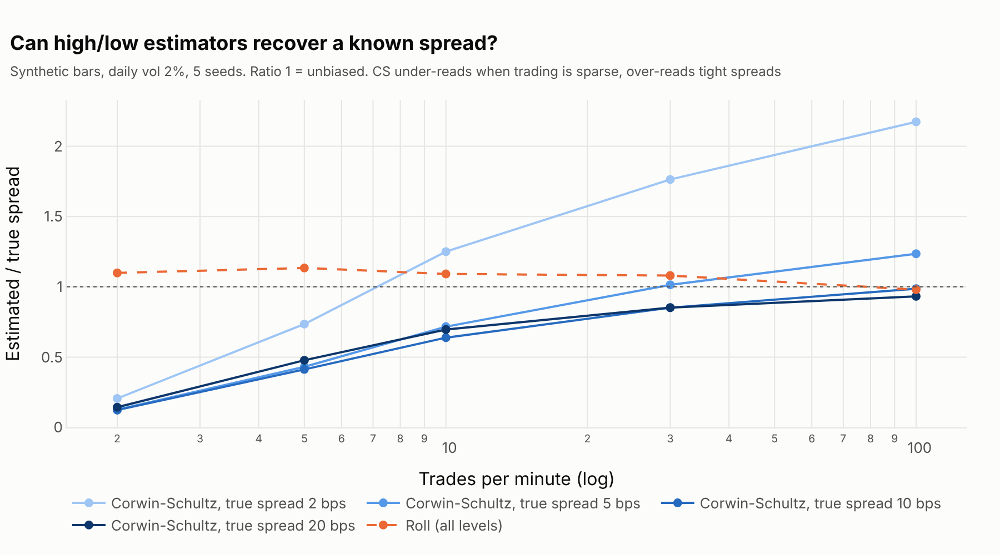

# Equity Execution & TCA Toolkit

Best execution, market microstructure and liquidity for **Mexican (BMV) and US equities/ETFs**,
built in Python + SQL with a Streamlit dashboard. The toolkit measures liquidity from 1-minute
bars, simulates TWAP / VWAP / POV / Implementation-Shortfall algorithms against real intraday
history with a square-root impact model, and decomposes every simulated order's cost
(spread, impact, timing, opportunity) the way a TCA report would.

Every number in this README is generated by `python -m src.pipeline` into
[`results/findings.md`](results/findings.md), from the cached data in `data/cache/` and a
formula documented in the code. 36 unit tests check the formulas against hand-computed values.

**Universe**: Walmex, Grupo México, América Móvil, Banorte, NAFTRAC (BMV) · IVV, Apple (US).
**Sample**: 19-20 sessions of 1-minute bars, 2026-10-19 to 2026-11-13 (yfinance).

---

## Headline findings

### 1. Cost grows with the square root of size, and Mexico's problem is notional, not %ADV



Mean implementation shortfall of a full-session VWAP order (bps vs arrival, buys and sells pooled):

| | 1% ADV | 5% ADV | 10% ADV | 20% ADV |
|---|---|---|---|---|
| Banorte (GFNORTEO) | 15.1 | 30.9 | 40.8 | 52.1 |
| Walmex | 15.4 | 31.1 | 40.9 | 52.0 |
| América Móvil (AMXB) | 21.6 | 42.0 | 54.3 | 67.8 |
| Grupo México (GMEXICOB) | 23.6 | 48.4 | 63.8 | 81.2 |
| NAFTRAC | 39.7 | 46.4 | 49.4 | 52.2 |
| Apple | 13.9 | 28.4 | 38.0 | 49.5 |
| IVV | 8.5 | 17.4 | 23.0 | 29.4 |

At the same %ADV, Banorte and Walmex cost about the same as Apple: the square-root law
prices participation and volatility, not market cap. The difference is notional: 5% of ADV is
**USD 2.3m in the median MX name vs USD 514m in the median US name**. NAFTRAC is the outlier:
small orders are already expensive because the lit book trades in only ~23% of minutes. Its
liquidity sits in creations/redemptions and block crosses, so a schedule that works every
minute is the wrong tool for it.

### 2. Mexican names are two to three orders of magnitude shallower, and half their volume isn't on the lit continuous book



* Depth proxy (USD traded per 1 bp of 1-minute price move): US names absorb **~409x** more
  than MX names (medians: USD 4.4m vs USD 10.7k per bp).
* Only **~49%** of an MX name's official daily volume shows up as executable continuous-session
  volume in the 1-minute bars. The rest is opening/closing auctions, block crosses (*cruces*,
  prints > 25x the day's median minute) and, after the US DST switch, BMV's last trading hour,
  which yfinance does not serve (see *Data quality*). An algo that targets "% of volume" in
  Mexico is targeting a much smaller pool than ADV suggests.

### 3. Spreads are widest at the open; volume piles up into the close



* First 30 minutes vs mid-session spread: **1.6x in Mexico** (5.6 vs 3.5 bps) and **3.2x in the
  US** (3.6 vs 1.1 bps). The last 30 minutes carry the largest share of continuous volume
  (US 15.6%; MX 23.7% on the days where the full session is observed).
* Scheduling consequence: delay the spread-sensitive part of an order past the first
  30-60 minutes, and let a VWAP curve load the afternoon, since the cheap liquidity is there.
  For MX the closing auction is a large, separate liquidity pool that these bars do not show.

### 4. Impact vs timing risk: urgency buys risk reduction at a predictable price



For a 10%-ADV Banorte order, moving from TWAP (urgency 0) to an Almgren-Chriss schedule with
urgency 3 raises expected cost from **42.9 to 49.0 bps (+6.1)** and cuts timing risk (std of
shortfall) from **95.3 to 76.9 bps (-19%)**. The schedules simulated on real 1-minute history
(dots) land on the analytic frontier, which is calibrated from the same square-root model.
VWAP is the cheapest schedule that completes, in every name and size. POV 10% looks cheaper
because it doesn't finish (59% filled) and pushes the rest to the next day, with the highest
risk of all (σ 123 bps).

### 5. High/low spread estimators fail in exactly the names where you need them (Bloomberg check pending)



On synthetic bars with a known spread, Corwin-Schultz recovers the true spread only when there
are many trades per minute and the spread is wide relative to 1-minute volatility. It
**under-reads by 50-85% when trading is sparse** (2-5 trades/minute) and **over-reads tight
spreads** (2.2x for a 2 bps spread at 100 trades/minute). Roll is unbiased on average (ratio
1.05) but noisy day to day (median correlation with the truth 0.39 vs 0.69 for CS). On the
real data, CS gives ~0 bps for NAFTRAC and 0.8-1.9 bps for IVV/AAPL, whose true quoted spreads are
~0.1-0.3 bps. That is why the model uses Roll for sparse names and floors every spread at one
tick. Validating both estimators against the **Bloomberg quoted spread** (question 5 below) is
the next step: [`docs/bloomberg_extraction.md`](docs/bloomberg_extraction.md).

---

## Questions this project answers

| # | Question | Where |
|---|---|---|
| 1 | Cost of executing 1/5/10/20% of ADV per name and algorithm | `results/cost_table.csv`, `sql/queries/01_cost_by_size_algo.sql`, dashboard *Pre-trade cost* |
| 2 | Mexico vs US on spread, depth and impact | `results/liquidity_summary.csv`, `02_mx_vs_us_liquidity.sql` |
| 3 | When liquidity is best intraday and how it shapes scheduling | `results/intraday_profile.csv`, `03_intraday_profile.sql` |
| 4 | Impact vs timing risk (Almgren-Chriss frontier, Banorte) | `results/ac_frontier.csv`, `results/ac_simulated.csv` |
| 5 | Corwin-Schultz / Roll accuracy vs real quoted spread | `results/synthetic_validation.csv` (+ `bbg_validation.csv` once Bloomberg data exists) |

## Data

One interface, `load_bars(ticker, source) -> timestamp, open, high, low, close, volume, bid, ask`
(`src/data/loaders.py`), behind three sources:

* **yfinance** (primary, runs anywhere): 1-minute bars downloaded in 7-day chunks over the last
  ~30 days, de-duplicated, converted to exchange local time and cached to
  `data/cache/<ticker>_1m.parquet`. Re-running the downloader merges into the cache, so history
  accumulates beyond 30 days. Daily bars give the official close and full-day volume (ADV); USD/MXN
  (`MXN=X`) converts MX notionals. No bid/ask: spreads are **estimated**.
* **Bloomberg** (optional, validation only): CSV exports with real bid/ask in `data/raw/bbg/`,
  never committed. The code runs fully without them.
* **Synthetic** (`src/data/synthetic.py`): bars generated from a known process (random-walk mid,
  Poisson trades bouncing between bid and ask, U-shaped volume, mean-reverting U-shaped spread)
  with a **known true spread**, used for tests and to measure estimator bias.

### Data quality: what had to be fixed

| Issue | Evidence | Treatment |
|---|---|---|
| BMV session moves with US daylight time (07:30-14:00 CDMX until 31 Oct, 08:30-15:00 after) | first bar 07:30 vs 08:30 | Session times are date-aware (`src/config.session_times`); intraday profiles use *minutes since open*, not clock time |
| yfinance stops BMV bars at 13:59 in both regimes: the last hour + closing auction are missing after the switch | 330 vs 390 bars/day; MX lead-lag vs IVV peaks at 1 minute, not 60, so the timestamps are not shifted | Documented; profiles average each bucket only over days where it is observed; simulations stop at the last available bar |
| Huge single-minute prints: block crosses at BMV, bad prints for AAPL (1-min volume sums to ~2x daily volume) | e.g. 17.9m AAPL shares in one minute | Prints > 25x the day's median minute are flagged `vol_outlier` and excluded from *executable* volume (kept in the data) |
| Opening auction inside the first bar | first-bar volume spikes | Flagged `is_open_auction`; excluded from continuous metrics; its close is the arrival price |
| NAFTRAC trades in ~23% of minutes | missing minutes | Minute grid filled with zero-volume bars; Roll instead of Corwin-Schultz |

## Methodology

Costs are in **basis points**, positive = cost to the trader (buy above benchmark). Times are
exchange local (America/Mexico_City, America/New_York). Formulas are repeated in each function's
docstring.

**Spread estimators** (`src/liquidity/spread_estimators.py`)
* Corwin-Schultz (2012) on consecutive 1-minute bars:
  β = ln²(H_t/L_t) + ln²(H_{t+1}/L_{t+1}), γ = ln²(max H / min L),
  α = (√(2β) − √β)/(3 − 2√2) − √(γ/(3 − 2√2)), S = 2(e^α − 1)/(1 + e^α).
  Gap adjustment between bars, pairs never cross days, **negative two-bar estimates set to 0
  before averaging** (CS 2012 main spec); aggregation window = day or 30-minute time-of-day bucket.
* Roll (1984): S = 2√(−Cov(r_t, r_{t−1})) on 1-minute log returns within the day, 0 if Cov ≥ 0.
* Model spread for the simulator: CS by 30-min bucket, or flat Roll when fewer than 50% of minutes
  trade; floored at one tick (0.01 / price).

**Liquidity metrics** (`src/liquidity/metrics.py`): ADV = 20-day mean official volume; σ_d = 60-day
std of daily log returns; Amihud = mean(|r_d|·10⁴ / USD volume in $m); depth proxy = median daily
Σ USD executable volume / Σ |1-min return| in bps; intraday volume profile = mean volume per
30-minute bucket since the open, normalized.

**Impact** (`src/execution/impact.py`): pre-trade cost = spread/2 + k·σ_d·√(Q/ADV), with **k = 0.7**
(the literature ranges 0.5-1; sensitivity at 0.5 and 1.0 is in `results/impact_sensitivity.csv`).
In the simulator the same law is applied per minute to the participation rate ρ_t (our share of
volume over a rolling 5-minute window): impact_t = k·σ_d·√ρ_t. At constant participation over the
day both coincide; faster or uneven trading costs more.

**Algorithms** (`src/execution/algos.py`): TWAP (equal slices); VWAP (slices ∝ a leave-one-day-out
historical volume curve, no look-ahead); POV (q_t = ρ/(1−ρ)·V_t, reacts to realized volume, may not
finish); IS = Almgren-Chriss holdings x_j = sinh(κ(N−j))/sinh(κN) with urgency κN. All integer
schedules sum exactly to the parent quantity (largest-remainder rounding).

**Simulator** (`src/execution/simulator.py`): fill_t = ref_t·(1 + side·(spread_t/2 + impact_t)/10⁴),
ref_t = typical price (H+L+C)/3 of the minute. ADV and σ use only data before the order date.
Orders start after the opening auction and run until the last bar of the day. Deterministic.

**TCA** (`src/tca/analysis.py`): slippage vs arrival, interval VWAP and official close. Perold
decomposition in bps of parent notional, **timing + spread + impact + opportunity = total** (exact
identity, tested). Opportunity cost on unfilled shares = drift to the close + the pre-trade cost of
finishing next session.

**Almgren-Chriss frontier**: linear temporary impact η calibrated so a uniform schedule costs the
same as under the square-root model; per-minute σ from intraday realized volatility; frontier
E = η·Σn_j², V = σ²·Σx_j² over a grid of risk aversions, plus the same schedules simulated on history.

## Limitations

* **Spreads from yfinance are estimates, not quoted spreads**, and Corwin-Schultz at 1-minute
  frequency is biased in both directions (finding 5). US spread estimates are upper bounds.
* **Impact is modeled, not observed fills.** The square-root coefficient is a literature prior,
  not calibrated to fills; the simulator assumes our trades don't feed back into later prices and
  every child order crosses the spread (no passive fills, no dark/block liquidity).
* 1-minute bars over ~20 sessions: no order-book depth, no tick data, no auction modeling. BMV's
  last hour is missing after 2 Nov. Results are illustrative of method, not a production cost model.
* Pooling buys and sells removes the sample's market drift from mean costs; timing risk shows up
  in the dispersion (σ) instead.

## Quickstart

```bash
pip install -r requirements-dev.txt
```

```bash
python -m src.pipeline
```

```bash
pytest
```

```bash
streamlit run app/streamlit_app.py
```

The data cache is committed, so the pipeline and the dashboard run offline. To refresh it
(yfinance only serves the last ~30 days of 1-minute bars, merged into the cache):

```bash
python -m src.pipeline --refresh
```

The pipeline also builds `data/tca.db` (SQLite, schema in `sql/schema.sql`). The queries in
`sql/queries/` run directly in it, e.g.:

```bash
sqlite3 -header -column data/tca.db < sql/queries/01_cost_by_size_algo.sql
```

The same database can feed a Power BI report (SQLite ODBC connector).

### Dashboard deployment (Streamlit Community Cloud)

New app → this repository → main file `app/streamlit_app.py` → Python 3.11. It installs
`requirements.txt` and reads the committed cache and `results/`.

## Repository layout

```
src/
  config.py      universe, sessions (DST-aware BMV hours), parameters
  data/          yf_loader (chunked 1m download + cache), bbg_loader, loaders (load_bars, enrich_bars),
                 synthetic (known-spread generator), db (SQLite)
  liquidity/     metrics (ADV, vol, Amihud, depth, profiles), spread_estimators (CS, Roll, validation)
  execution/     algos (TWAP, VWAP, POV, IS/AC + frontier), impact (square-root), simulator
  tca/           analysis (slippage, Perold decomposition, summaries)
  reporting/     charts (Plotly), findings (auto-generated results/findings.md)
  pipeline.py    end-to-end run
app/             streamlit_app.py
sql/             schema.sql, queries/*.sql
notebooks/       01_liquidity, 02_execution, 03_findings (executed)
tests/           pytest: every metric, algo and the decomposition identity
docs/            bloomberg_extraction.md, writeup.md
```

## References

Almgren & Chriss (2000), *Optimal execution of portfolio transactions* · Almgren, Thum, Hauptmann
& Li (2005), *Direct estimation of equity market impact* · Amihud (2002) · Bouchaud, Bonart,
Donier & Gould (2018), *Trades, Quotes and Prices* · Corwin & Schultz (2012), *A simple way to
estimate bid-ask spreads from daily high and low prices* · Perold (1988), *The implementation
shortfall* · Roll (1984) · Tóth et al. (2011), *Anomalous price impact and the critical nature of
liquidity*.

Data: Yahoo Finance via `yfinance`, for research and education. Bloomberg data is not distributed.
